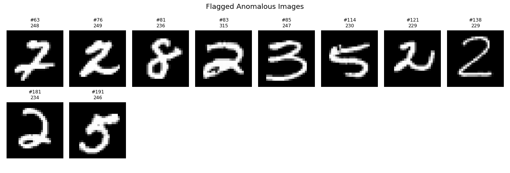
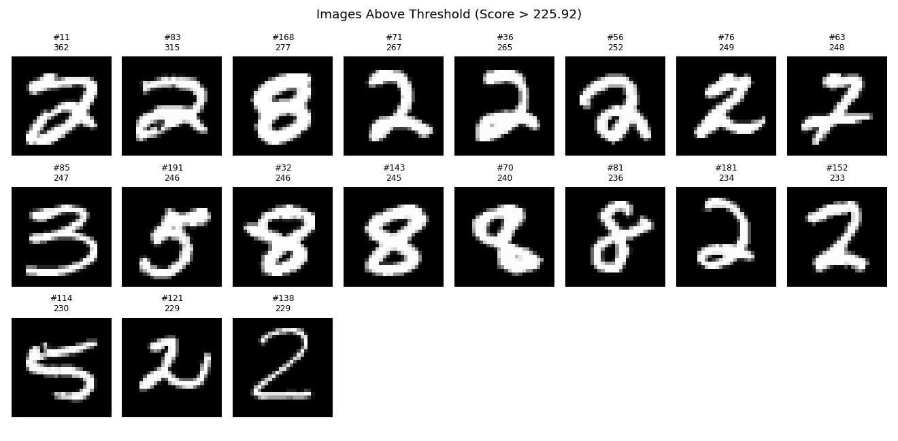
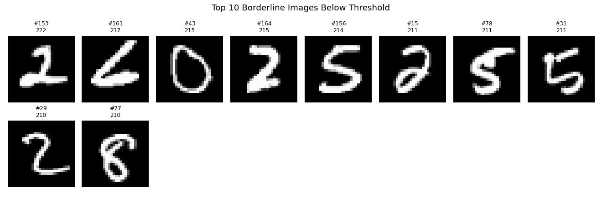

# VAE Anomaly Audit: Batch 200 Intake Quality and Distribution Report

# VAE Anomaly Audit: Batch 200 Quality and Distribution Analysis

## Executive Summary

An audit was performed on the incoming batch of 200 intake scan images (indices 0 to 199). The anomaly detection system evaluates reconstruction error of `decode(mu)` across 784 pixels under a Variational Autoencoder (VAE) trained on nine seen digit classes.

### Batch Summary Statistics
- **Total Images Scored**: 200
- **Reconstruction Score Mean**: 152.3
- **Reconstruction Score Median**: 155.47
- **Reconstruction Score Minimum**: 33.36
- **Reconstruction Score Maximum**: 362.15
- **Reconstruction Score Standard Deviation**: 57.76
- **Nominal Detection Threshold**: 225.92 (set at the 95th percentile of seen-digit validation scores)
- **Baseline Calibration**: On test data, false alarm rate is 4.6% and detection rate is 51.0%
- **Raw Count Scoring Above Threshold**: 19 images
- **Final Flagged Anomalies**: 10 images

---

## Audit Methodology: Threshold as a Guide, Not a Verdict

The nominal threshold of 225.92 flags images exceeding the 95th percentile of seen-digit validation reconstruction errors. However, an elevated reconstruction score can arise through two distinct mechanisms:
1. **True Morphological Anomalies**: The digit belongs to an unseen class or exhibits an unfamiliar shape, causing it to fall outside established latent clusters (where distance to nearest seen clusters exceeds typical cluster distances) or generate high error despite standard/low ink density.
2. **Stroke Thickness Artifacts (False Alarms)**: Binary cross-entropy reconstruction loss sums pixel penalties across the full 784-pixel grid. Digits drawn with heavy stroke weight (ink pixels well above the seen-digit median of 99) incur large penalties on extra foreground pixels even when their latent representation lies dead center within a seen-digit cluster.

Each of the 19 images scoring above the 225.92 threshold, alongside borderline candidates scoring just below threshold, was audited using latent cluster distances and stroke pixel counts.

---

## Confirmed Anomalous Images (Flagged)

The following 10 images are judged genuinely anomalous based on morphological mismatch, elevated latent cluster distances, or high reconstruction errors that cannot be attributed to ink thickness:

- **#63**: Score 247.91 (97.8th percentile). Sampled score mean 249.94, std 6.95, fraction above threshold 1.0. Ink pixels: 127 vs median 99. Latent position: [0.612, -0.4]. Nearest clusters: digit 5 (distance 0.307, typical 0.893) and digit 6 (distance 0.54, typical 0.43). Distance to cluster 6 exceeds typical radius.
- **#76**: Score 248.95 (97.9th percentile). Sampled score mean 249.32, std 8.1, fraction above threshold 1.0. Ink pixels: 145. Latent position: [0.555, -0.106]. Nearest clusters: digit 6 (distance 0.499, typical 0.43) and digit 5 (distance 0.509, typical 0.893). Distance to cluster 6 exceeds typical radius.
- **#81**: Score 236.28 (96.6th percentile). Sampled score mean 236.36, std 2.75, fraction above threshold 1.0. Ink pixels: 139. Latent position: [0.278, -0.149]. Nearest clusters: digit 8 (distance 0.417, typical 0.927) and digit 5 (distance 0.436, typical 0.893).
- **#83**: Score 314.81 (99.9th percentile). Sampled score mean 317.21, std 13.5, fraction above threshold 1.0. Ink pixels: 168. Latent position: [0.405, 0.068]. Nearest clusters: digit 8 (distance 0.606, typical 0.927) and digit 5 (distance 0.647, typical 0.893). Exceptionally high reconstruction error across all sampled latent codes.
- **#85**: Score 246.77 (97.7th percentile). Sampled score mean 247.81, std 2.4, fraction above threshold 1.0. Ink pixels: 136. Latent position: [0.299, -1.461]. Nearest clusters: digit 3 (distance 0.52, typical 0.75) and digit 5 (distance 0.886, typical 0.893).
- **#114**: Score 229.59 (95.6th percentile). Sampled score mean 231.17, std 3.69, fraction above threshold 1.0. Ink pixels: 120. Latent position: [0.004, -0.461]. Nearest clusters: digit 8 (distance 0.29, typical 0.927) and digit 5 (distance 0.375, typical 0.893).
- **#121**: Score 229.13 (95.5th percentile). Sampled score mean 228.77, std 5.67, fraction above threshold 0.65. Ink pixels: 99 (exactly equal to seen median 99). Latent position: [0.6, 0.366]. Nearest clusters: digit 6 (distance 0.644, typical 0.43) and digit 8 (distance 0.932, typical 0.927). Lies far beyond the typical cluster boundary of both nearest seen digits, showing clear unfamiliar geometry.
- **#138**: Score 228.52 (95.4th percentile). Sampled score mean 229.24, std 2.48, fraction above threshold 1.0. Ink pixels: 72 (27 pixels below seen median 99). Latent position: [0.523, -0.363]. Nearest clusters: digit 5 (distance 0.269, typical 0.893) and digit 6 (distance 0.597, typical 0.43). Despite light ink strokes, exhibits high reconstruction error across 100% of latent samples.
- **#181**: Score 234.1 (96.3th percentile). Sampled score mean 233.92, std 3.68, fraction above threshold 1.0. Ink pixels: 117. Latent position: [0.724, -0.074]. Nearest clusters: digit 6 (distance 0.331, typical 0.43) and digit 5 (distance 0.621, typical 0.893).
- **#191**: Score 246.34 (97.7th percentile). Sampled score mean 248.47, std 4.55, fraction above threshold 1.0. Ink pixels: 146. Latent position: [0.736, -1.348]. Nearest clusters: digit 3 (distance 0.44, typical 0.75) and digit 5 (distance 0.858, typical 0.893).

---

## Dismissed Candidates (Stroke Thickness False Alarms)

The following 9 images exceeded the 225.92 threshold purely due to heavy stroke thickness. All 9 reside within the core cluster radius of seen digit 5 and represent false alarms:

- **#11**: Score 362.15 (100th percentile). Latent position: [0.205, -0.684]. Nearest cluster: digit 5 at distance 0.188 (typical 0.893). Ink pixels: 187 (+88 above median 99). Deep inside digit 5 cluster; error driven by extreme ink density.
- **#32**: Score 246.25 (97.7th percentile). Latent position: [0.13, -0.472]. Nearest cluster: digit 5 at distance 0.253 (typical 0.893). Ink pixels: 195 (+96 above median 99).
- **#36**: Score 264.6 (98.8th percentile). Latent position: [0.486, -0.333]. Nearest cluster: digit 5 at distance 0.274 (typical 0.893). Ink pixels: 155 (+56 above median 99).
- **#56**: Score 252.35 (98.2th percentile). Latent position: [0.246, -0.275]. Nearest cluster: digit 5 at distance 0.323 (typical 0.893). Ink pixels: 159 (+60 above median 99).
- **#70**: Score 240.01 (97th percentile). Latent position: [0.046, -0.92]. Nearest cluster: digit 5 at distance 0.465 (typical 0.893). Ink pixels: 181 (+82 above median 99).
- **#71**: Score 266.5 (98.9th percentile). Latent position: [0.322, -0.698]. Nearest cluster: digit 5 at distance 0.127 (typical 0.893). Ink pixels: 137 (+38 above median 99).
- **#143**: Score 244.52 (97.5th percentile). Latent position: [0.142, -0.783]. Nearest cluster: digit 5 at distance 0.301 (typical 0.893). Ink pixels: 210 (+111 above median 99).
- **#152**: Score 233.07 (96.2th percentile). Latent position: [0.279, -0.54]. Nearest cluster: digit 5 at distance 0.089 (typical 0.893). Ink pixels: 137 (+38 above median 99).
- **#168**: Score 276.59 (99.2th percentile). Latent position: [0.296, -0.304]. Nearest cluster: digit 5 at distance 0.28 (typical 0.893). Ink pixels: 226 (+127 above median 99, batch maximum).

---

## Borderline Candidates Audited Below Threshold

Prominent images just below the 225.92 threshold were audited to verify stability:
- **#153**: Score 222.26 (94.3th percentile). Sampled score mean 226.27, std 3.73, fraction above threshold 0.45. Ink pixels: 124. Nearest cluster 6 (distance 0.489, typical 0.43). Borderline case exhibiting high score variance across sampled z codes.
- **#43**: Score 215.46 (93.2th percentile). Sampled score mean 215.14, std 8.8, fraction above threshold 0.1. Ink pixels: 91. Nearest cluster 6 (distance 0.775, typical 0.43) and cluster 0 (distance 1.166, typical 0.812).
- **#161**: Score 216.55 (93.4th percentile). Ink pixels: 151. Nearest cluster 0 (distance 0.667, typical 0.812). Fraction above threshold: 0.

---

## Contact Sheet Figures
- Figure 1: `audit_outputs/2b_main_20261126_214221_flagged_anomalies.png` (Contact sheet of the 10 flagged anomalous images)
- Figure 2: `audit_outputs/2b_main_20261126_214221_above_threshold_images.png` (Contact sheet of all 19 raw above-threshold images)
- Figure 3: `audit_outputs/2b_main_20261126_214221_borderline_below_threshold.png` (Contact sheet of the top 10 borderline images below threshold)

---
## Evidence table (generated by code from tool results)

Threshold 225.92 (95th percentile of seen-digit validation scores).

| image | score | percentile vs seen | status | sampled mean ± std | nearest seen cluster |
|---|---|---|---|---|---|
| #11 | 362.15 | 100.0 | not flagged | 364.65 ± 4.87 | 5 (d=0.188) |
| #32 | 246.25 | 97.7 | not flagged | 247.88 ± 1.47 | 5 (d=0.253) |
| #36 | 264.60 | 98.8 | not flagged | 266.32 ± 3.19 | 5 (d=0.274) |
| #56 | 252.35 | 98.2 | not flagged | 253.22 ± 2.0 | 5 (d=0.323) |
| #63 | 247.91 | 97.8 | FLAGGED | 249.94 ± 6.95 | 5 (d=0.307) |
| #70 | 240.01 | 97.0 | not flagged | 240.54 ± 0.75 | 5 (d=0.465) |
| #71 | 266.50 | 98.9 | not flagged | 267.01 ± 1.06 | 5 (d=0.127) |
| #76 | 248.95 | 97.9 | FLAGGED | 249.32 ± 8.1 | 6 (d=0.499) |
| #81 | 236.28 | 96.6 | FLAGGED | 236.36 ± 2.75 | 8 (d=0.417) |
| #83 | 314.81 | 99.9 | FLAGGED | 317.21 ± 13.5 | 8 (d=0.606) |
| #85 | 246.77 | 97.7 | FLAGGED | 247.81 ± 2.4 | 3 (d=0.52) |
| #114 | 229.59 | 95.6 | FLAGGED | 231.17 ± 3.69 | 8 (d=0.29) |
| #121 | 229.13 | 95.5 | FLAGGED | 228.77 ± 5.67 | 6 (d=0.644) |
| #138 | 228.52 | 95.4 | FLAGGED | 229.24 ± 2.48 | 5 (d=0.269) |
| #143 | 244.52 | 97.5 | not flagged | 245.25 ± 2.05 | 5 (d=0.301) |
| #152 | 233.07 | 96.2 | not flagged | 234.86 ± 1.93 | 5 (d=0.089) |
| #168 | 276.59 | 99.2 | not flagged | 274.96 ± 7.85 | 5 (d=0.28) |
| #181 | 234.10 | 96.3 | FLAGGED | 233.92 ± 3.68 | 6 (d=0.331) |
| #191 | 246.34 | 97.7 | FLAGGED | 248.47 ± 4.55 | 3 (d=0.44) |

## Figures

_Run `2b_main_20261126_214221`, model `gemini-3.8-flash`, 2026-11-26 22:20_
