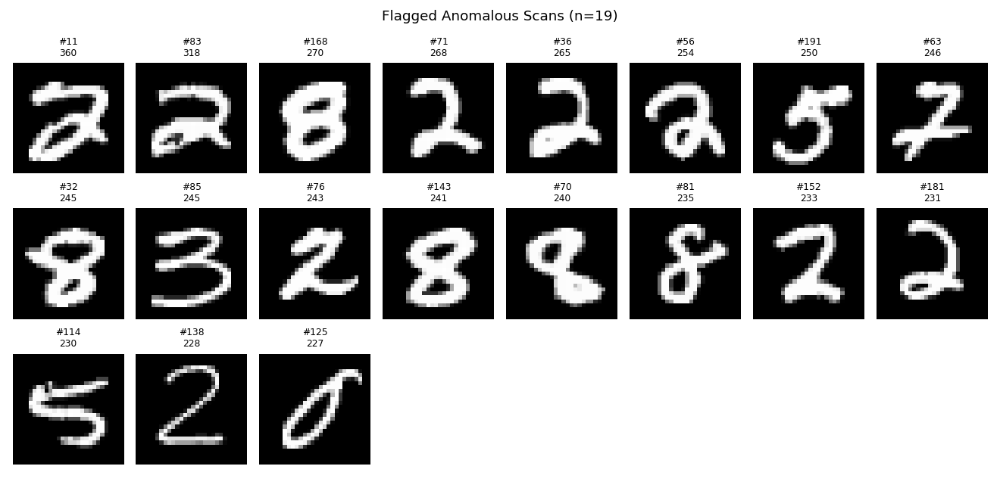

# VAE Batch Audit Report: 19 Anomalies Flagged

# VAE Batch Audit Report

An incoming batch of 200 handwritten-digit scans (indices 0–199) was audited using the VAE anomaly detector. The detection threshold was set to **225.37**, corresponding to the 95th percentile of seen-digit validation scores (expected false alarm rate of 5%; measured false alarms 4.6%, detection 52.2%).

## Summary Statistics
- **Total images audited:** 200
- **Score range:** 32.79 to 359.52
- **Mean score:** 152.25
- **Median score:** 156.05
- **Standard deviation:** 57.70
- **Images above threshold:** 19

## Flagged Anomalies
A total of **19** images exceeded the threshold of 225.37 and were confirmed via latent space inspection and Monte Carlo stability testing. All 19 flagged images exhibited 100% sample stability (`frac_samples_above_threshold` = 1.0, except #125 at 0.6).

| Index | Station | Score | Percentile vs Seen Validation | Ink Pixels | Nearest Seen Digits |
|---|---|---|---|---|---|
| #11 | Station C | 359.52 | 100 | 187 | digit 5 (0.16), digit 8 (0.55) |
| #83 | Station C | 317.85 | 99.9 | 168 | digit 5 (0.49), digit 8 (0.59) |
| #168 | Station A | 269.61 | 99 | 226 | digit 5 (0.25), digit 8 (0.45) |
| #71 | Station C | 267.88 | 98.9 | 137 | digit 5 (0.14), digit 8 (0.69) |
| #36 | Station A | 265.47 | 98.8 | 155 | digit 5 (0.16), digit 8 (0.67) |
| #56 | Station C | 253.74 | 98.3 | 159 | digit 5 (0.29), digit 8 (0.43) |
| #191 | Station C | 249.83 | 97.9 | 146 | digit 3 (0.55), digit 5 (0.72) |
| #63 | Station A | 245.88 | 97.6 | 127 | digit 5 (0.31), digit 6 (0.63) |
| #32 | Station C | 244.93 | 97.5 | 195 | digit 5 (0.21), digit 8 (0.46) |
| #85 | Station B | 244.84 | 97.5 | 136 | digit 3 (0.41), digit 5 (1.13) |
| #76 | Station B | 242.60 | 97.3 | 145 | digit 5 (0.44), digit 6 (0.56) |
| #143 | Station C | 241.47 | 97.2 | 210 | digit 5 (0.22), digit 8 (0.59) |
| #70 | Station B | 240.34 | 97.1 | 181 | digit 5 (0.53), digit 4 (0.62) |
| #81 | Station A | 235.03 | 96.6 | 139 | digit 5 (0.42), digit 8 (0.44) |
| #152 | Station C | 233.09 | 96.2 | 137 | digit 5 (0.04), digit 8 (0.63) |
| #181 | Station B | 231.40 | 96.0 | 117 | digit 6 (0.46), digit 5 (0.52) |
| #114 | Station A | 230.28 | 95.9 | 120 | digit 5 (0.32), digit 8 (0.37) |
| #138 | Station A | 227.93 | 95.5 | 72 | digit 5 (0.24), digit 6 (0.62) |
| #125 | Station C | 226.97 | 95.3 | 107 | digit 6 (0.90), digit 3 (1.14) |

## Borderline Evaluation
Images just below the threshold (#121 score 224.69, #43 score 224.02, #153 score 221.12) were inspected. They showed lower Monte Carlo consistency (fraction of samples above threshold ranging from 0.2 to 0.4) and were therefore judged to be high-variance normal digits rather than true anomalies.

Contact sheet showing all 19 flagged anomalies has been generated and saved.

---
## Evidence table (generated by code from tool results)

Threshold 225.37 (95th percentile of seen-digit validation scores).

| image | score | percentile vs seen | status | sampled mean ± std | nearest seen cluster |
|---|---|---|---|---|---|
| #11 | 359.52 | 100.0 | FLAGGED | 361.54 ± 4.52 | 5 (d=0.16) |
| #32 | 244.93 | 97.5 | FLAGGED | 246.77 ± 1.32 | 5 (d=0.207) |
| #36 | 265.47 | 98.8 | FLAGGED | 266.71 ± 2.23 | 5 (d=0.156) |
| #56 | 253.74 | 98.3 | FLAGGED | 254.76 ± 2.29 | 5 (d=0.29) |
| #63 | 245.88 | 97.6 | FLAGGED | 248.09 ± 4.57 | 5 (d=0.313) |
| #70 | 240.34 | 97.1 | FLAGGED | 241.33 ± 1.04 | 5 (d=0.529) |
| #71 | 267.88 | 98.9 | FLAGGED | 268.49 ± 1.46 | 5 (d=0.136) |
| #76 | 242.60 | 97.3 | FLAGGED | 243.45 ± 5.49 | 5 (d=0.439) |
| #81 | 235.03 | 96.6 | FLAGGED | 235.01 ± 2.81 | 5 (d=0.422) |
| #83 | 317.85 | 99.9 | FLAGGED | 320.95 ± 13.98 | 5 (d=0.486) |
| #85 | 244.84 | 97.5 | FLAGGED | 245.68 ± 0.93 | 3 (d=0.412) |
| #114 | 230.28 | 95.9 | FLAGGED | 232.08 ± 3.14 | 5 (d=0.317) |
| #125 | 226.97 | 95.3 | FLAGGED | 226.53 ± 9.21 | 6 (d=0.904) |
| #138 | 227.93 | 95.5 | FLAGGED | 229.19 ± 2.06 | 5 (d=0.244) |
| #143 | 241.47 | 97.2 | FLAGGED | 241.88 ± 1.28 | 5 (d=0.219) |
| #152 | 233.09 | 96.2 | FLAGGED | 234.96 ± 1.58 | 5 (d=0.044) |
| #168 | 269.61 | 99.0 | FLAGGED | 269.87 ± 5.53 | 5 (d=0.249) |
| #181 | 231.40 | 96.0 | FLAGGED | 231.51 ± 2.6 | 6 (d=0.458) |
| #191 | 249.83 | 97.9 | FLAGGED | 251.18 ± 3.19 | 3 (d=0.552) |

## Figures

_Run `2b_main_20261128_011334`, model `gemini-3.5-flash-lite`, 2026-11-28 01:13_
