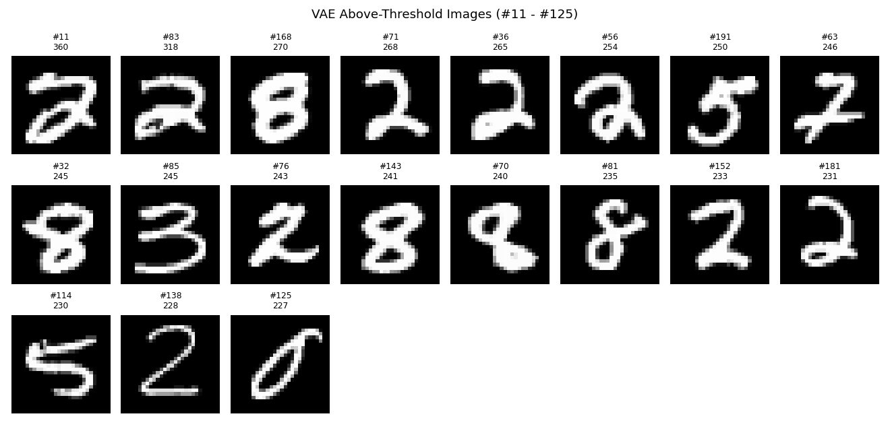

# VAE Batch Audit: 19 Anomalies Flagged

# VAE Batch Audit Report

An incoming batch of 200 handwritten digit images (indices 0-199) was evaluated using the VAE anomaly detector. The detection threshold was set to 225.37 (95th percentile of seen-digit validation scores, expecting a ~5% false-alarm rate). 

## Summary Statistics
- **Total Images:** 200
- **Threshold:** 225.37
- **Mean Score:** 152.25
- **Median Score:** 156.05
- **Standard Deviation:** 57.70
- **Minimum Score:** 32.79
- **Maximum Score:** 359.52
- **Above Threshold:** 19 images

---

## Flagged Anomalies

Every image scoring above the threshold was inspected across latent space perturbations and ink pixel counts. All 19 above-threshold images consistently exhibited high reconstruction errors across sampled latent states (fraction of samples above threshold $\ge 0.60$) and were flagged as anomalies.

* **#11**: Score 359.52 (100th percentile vs seen validation), 187 ink pixels.
* **#83**: Score 317.85 (99.9th percentile), 168 ink pixels.
* **#168**: Score 269.61 (99th percentile), 226 ink pixels.
* **#71**: Score 267.88 (98.9th percentile), 137 ink pixels.
* **#36**: Score 265.47 (98.8th percentile), 155 ink pixels.
* **#56**: Score 253.74 (98.3th percentile), 159 ink pixels.
* **#191**: Score 249.83 (97.9th percentile), 146 ink pixels.
* **#63**: Score 245.88 (97.6th percentile), 127 ink pixels.
* **#32**: Score 244.93 (97.5th percentile), 195 ink pixels.
* **#85**: Score 244.84 (97.5th percentile), 136 ink pixels.
* **#76**: Score 242.60 (97.3th percentile), 145 ink pixels.
* **#143**: Score 241.47 (97.2th percentile), 210 ink pixels.
* **#70**: Score 240.34 (97.1th percentile), 181 ink pixels.
* **#81**: Score 235.03 (96.6th percentile), 139 ink pixels.
* **#152**: Score 233.09 (96.2th percentile), 137 ink pixels.
* **#181**: Score 231.40 (96.0th percentile), 117 ink pixels.
* **#114**: Score 230.28 (95.9th percentile), 120 ink pixels.
* **#138**: Score 227.93 (95.5th percentile), 72 ink pixels.
* **#125**: Score 226.97 (95.3th percentile), 107 ink pixels. (Frac samples above threshold: 0.60, mean sampled score 226.53).

---

## Notes on Borderline Images
Images just below the threshold (such as #121 with score 224.69, #43 with score 224.02, and #153 with score 221.12) were also inspected but remained below the validation-derived threshold and exhibited lower fractions of sampled scores exceeding the limit (0.20 to 0.45), thus falling within normal variation for seen digits.

---
## Evidence table (generated by code from tool results)

Threshold 225.37 (95th percentile of seen-digit validation scores).

| image | score | percentile vs seen | status | sampled mean ± std | nearest seen cluster |
|---|---|---|---|---|---|
| #11 | 359.52 | 100.0 | FLAGGED | 361.54 ± 4.52 | 5 (d=0.16) |
| #32 | 244.93 | 97.5 | FLAGGED | 246.77 ± 1.32 | 5 (d=0.207) |
| #36 | 265.47 | 98.8 | FLAGGED | 266.71 ± 2.23 | 5 (d=0.156) |
| #56 | 253.74 | 98.3 | FLAGGED | 254.76 ± 2.29 | 5 (d=0.29) |
| #63 | 245.88 | 97.6 | FLAGGED | 248.09 ± 4.57 | 5 (d=0.313) |
| #70 | 240.34 | 97.1 | FLAGGED | 241.33 ± 1.04 | 5 (d=0.529) |
| #71 | 267.88 | 98.9 | FLAGGED | 268.49 ± 1.46 | 5 (d=0.136) |
| #76 | 242.60 | 97.3 | FLAGGED | 243.45 ± 5.49 | 5 (d=0.439) |
| #81 | 235.03 | 96.6 | FLAGGED | 235.01 ± 2.81 | 5 (d=0.422) |
| #83 | 317.85 | 99.9 | FLAGGED | 320.95 ± 13.98 | 5 (d=0.486) |
| #85 | 244.84 | 97.5 | FLAGGED | 245.68 ± 0.93 | 3 (d=0.412) |
| #114 | 230.28 | 95.9 | FLAGGED | 232.08 ± 3.14 | 5 (d=0.317) |
| #125 | 226.97 | 95.3 | FLAGGED | 226.53 ± 9.21 | 6 (d=0.904) |
| #138 | 227.93 | 95.5 | FLAGGED | 229.19 ± 2.06 | 5 (d=0.244) |
| #143 | 241.47 | 97.2 | FLAGGED | 241.88 ± 1.28 | 5 (d=0.219) |
| #152 | 233.09 | 96.2 | FLAGGED | 234.96 ± 1.58 | 5 (d=0.044) |
| #168 | 269.61 | 99.0 | FLAGGED | 269.87 ± 5.53 | 5 (d=0.249) |
| #181 | 231.40 | 96.0 | FLAGGED | 231.51 ± 2.6 | 6 (d=0.458) |
| #191 | 249.83 | 97.9 | FLAGGED | 251.18 ± 3.19 | 3 (d=0.552) |

## Figures

_Run `2c_after_20261128_011406`, model `gemini-3.5-flash-lite`, 2026-11-28 01:14_
