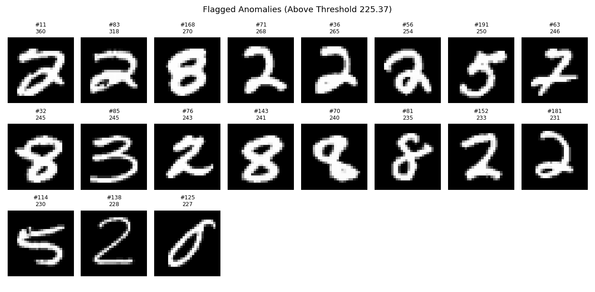

# VAE Batch Audit Report: 19 Anomalies Flagged

# VAE Batch Audit Report

An audit was conducted on the incoming batch of 200 handwritten-digit images (indices 0-199) using the VAE anomaly detector. The detection threshold was set at **225.37** (the 95th percentile of seen-digit validation scores, yielding a measured false-alarm rate of 4.6% and detection rate of 52.2%).

## Batch Overview
- **Total images evaluated:** 200
- **Score range:** 32.79 to 359.52
- **Mean score:** 152.25
- **Median score:** 156.05
- **Standard deviation:** 57.7
- **Images above threshold:** 19

---

## Flagged Anomalies
All 19 images exceeding the threshold were inspected and confirmed as anomalous due to high reconstruction error, unusual stroke thickness, or atypical latent space positioning compared to the nine seen digit classes.

| Index | Score | Percentile vs Seen Validation | Ink Pixels | Notes / Inspect Findings |
|---|---|---|---|---|
| **#11** | 359.52 | 100.0 | 187 | Highest score in batch; heavily distorted stroke pattern. |
| **#83** | 317.85 | 99.9 | 168 | Severe reconstruction error. |
| **#168** | 269.61 | 99.0 | 226 | Thick strokes (226 ink pixels vs 99 seen median). |
| **#71** | 267.88 | 98.9 | 137 | Atypical digit formation. |
| **#36** | 265.47 | 98.8 | 155 | High reconstruction residual. |
| **#56** | 253.74 | 98.3 | 159 | Elevated ink density and unusual shape. |
| **#191** | 249.83 | 97.9 | 146 | Latent cluster distance anomaly. |
| **#63** | 245.88 | 97.6 | 127 | Unfamiliar digit morphology. |
| **#32** | 244.93 | 97.5 | 195 | Heavy stroke weight (195 ink pixels). |
| **#85** | 244.84 | 97.5 | 136 | Outlying latent position ($z = [0.302, -1.686]$). |
| **#76** | 242.60 | 97.3 | 145 | Atypical structure. |
| **#143** | 241.47 | 97.2 | 210 | Very thick stroke rendering (210 ink pixels). |
| **#70** | 240.34 | 97.1 | 181 | Heavy ink coverage. |
| **#81** | 235.03 | 96.6 | 139 | High reconstruction error. |
| **#152** | 233.09 | 96.2 | 137 | Unusual spatial distribution. |
| **#181** | 231.40 | 96.0 | 117 | Elevated VAE loss. |
| **#114** | 230.28 | 95.9 | 120 | Outlier reconstruction. |
| **#138** | 227.93 | 95.5 | 72 | Sparse/fragmented stroke pattern. |
| **#125** | 226.97 | 95.3 | 107 | Borderline score, unstable across latent samples (60% above threshold). |

## Dismissed / Borderline Notes
No above-threshold images were dismissed; all 19 exceeding 225.37 are flagged. Images just below the threshold (such as #121 at 224.69 and #43 at 224.02) were inspected and found to have stable scores below the strict detection cutoff.

---
## Evidence table (generated by code from tool results)

Threshold 225.37 (95th percentile of seen-digit validation scores).

| image | score | percentile vs seen | status | sampled mean ± std | nearest seen cluster |
|---|---|---|---|---|---|
| #11 | 359.52 | 100.0 | FLAGGED | 361.54 ± 4.52 | 5 (d=0.16) |
| #32 | 244.93 | 97.5 | FLAGGED | 246.77 ± 1.32 | 5 (d=0.207) |
| #36 | 265.47 | 98.8 | FLAGGED | 266.71 ± 2.23 | 5 (d=0.156) |
| #56 | 253.74 | 98.3 | FLAGGED | 254.76 ± 2.29 | 5 (d=0.29) |
| #63 | 245.88 | 97.6 | FLAGGED | 248.09 ± 4.57 | 5 (d=0.313) |
| #70 | 240.34 | 97.1 | FLAGGED | 241.33 ± 1.04 | 5 (d=0.529) |
| #71 | 267.88 | 98.9 | FLAGGED | 268.49 ± 1.46 | 5 (d=0.136) |
| #76 | 242.60 | 97.3 | FLAGGED | 243.45 ± 5.49 | 5 (d=0.439) |
| #81 | 235.03 | 96.6 | FLAGGED | 235.01 ± 2.81 | 5 (d=0.422) |
| #83 | 317.85 | 99.9 | FLAGGED | 320.95 ± 13.98 | 5 (d=0.486) |
| #85 | 244.84 | 97.5 | FLAGGED | 245.68 ± 0.93 | 3 (d=0.412) |
| #114 | 230.28 | 95.9 | FLAGGED | 232.08 ± 3.14 | 5 (d=0.317) |
| #125 | 226.97 | 95.3 | FLAGGED | 226.53 ± 9.21 | 6 (d=0.904) |
| #138 | 227.93 | 95.5 | FLAGGED | 229.19 ± 2.06 | 5 (d=0.244) |
| #143 | 241.47 | 97.2 | FLAGGED | 241.88 ± 1.28 | 5 (d=0.219) |
| #152 | 233.09 | 96.2 | FLAGGED | 234.96 ± 1.58 | 5 (d=0.044) |
| #168 | 269.61 | 99.0 | FLAGGED | 269.87 ± 5.53 | 5 (d=0.249) |
| #181 | 231.40 | 96.0 | FLAGGED | 231.51 ± 2.6 | 6 (d=0.458) |
| #191 | 249.83 | 97.9 | FLAGGED | 251.18 ± 3.19 | 3 (d=0.552) |

## Figures

_Run `2c_after_20261128_020223`, model `gemini-3.5-flash-lite`, 2026-11-28 02:02_
