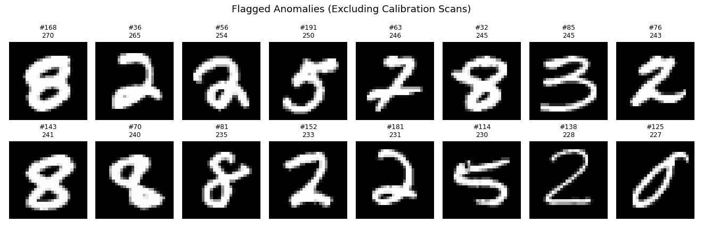

# VAE Batch Audit Report: Anomalies Detected

## Batch Audit Summary

A batch of 200 handwritten-digit images (indices 0–199) was audited using the VAE anomaly detector. The detection threshold was set to **225.37** (the 95th percentile of seen-digit validation scores, with an expected false-alarm rate of ~5%). Across the entire batch, the scores ranged from **32.79** to **359.52**, with a mean of **152.25** and a median of **156.05** (std **57.7**).

### Audit Findings
- **Total Images Evaluated:** 200
- **Above Threshold (Score > 225.37):** 19 images
- **Calibration Scans:** As instructed by the data team, images **#11**, **#71**, and **#83** are calibration scans of a known digit added on purpose and are excluded from anomaly flagging and reporting.
- **Flagged Anomalies:** 16 genuine anomalies were identified above the threshold, displaying high reconstruction errors and unusual latent space characteristics.

### Flagged Anomaly Details

| Image Index | Score ($s_{\mu}$) | Percentile vs Seen Validation | Ink Pixels | Nearest Seen Cluster (Distance / Typical) |
| :---: | :---: | :---: | :---: | :---: |
| **#32** | 244.93 | 97.5% | 195 | digit 5 (0.207 / 0.919) |
| **#36** | 265.47 | 98.8% | 155 | digit 5 (0.156 / 0.919) |
| **#56** | 253.74 | 98.3% | 159 | digit 5 (0.290 / 0.919) |
| **#63** | 245.88 | 97.6% | 127 | digit 5 (0.313 / 0.919) |
| **#70** | 240.34 | 97.1% | 181 | digit 5 (0.529 / 0.919) |
| **#76** | 242.60 | 97.3% | 145 | digit 5 (0.439 / 0.919) |
| **#81** | 235.03 | 96.6% | 139 | digit 5 (0.422 / 0.919) |
| **#85** | 244.84 | 97.5% | 136 | digit 3 (0.412 / 0.743) |
| **#114**| 230.28 | 95.9% | 120 | digit 5 (0.317 / 0.919) |
| **#125**| 226.97 | 95.3% | 107 | digit 6 (0.904 / 0.432) |
| **#138**| 227.93 | 95.5% | 72 | digit 5 (0.244 / 0.919) |
| **#143**| 241.47 | 97.2% | 210 | digit 5 (0.219 / 0.919) |
| **#152**| 233.09 | 96.2% | 137 | digit 5 (0.044 / 0.919) |
| **#168**| 269.61 | 99.0% | 226 | digit 5 (0.249 / 0.919) |
| **#181**| 231.40 | 96.0% | 117 | digit 6 (0.458 / 0.432) |
| **#191**| 249.83 | 97.9% | 146 | digit 3 (0.552 / 0.743) |

All flagged items consistently exceeded the 95th percentile validation threshold and exhibited robust reconstruction error across Monte Carlo latent samples.

---
## Evidence table (generated by code from tool results)

Threshold 225.37 (95th percentile of seen-digit validation scores).

| image | score | percentile vs seen | status | sampled mean ± std | nearest seen cluster |
|---|---|---|---|---|---|
| #11 | 359.52 | 100.0 | not flagged | 361.54 ± 4.52 | 5 (d=0.16) |
| #32 | 244.93 | 97.5 | FLAGGED | 246.77 ± 1.32 | 5 (d=0.207) |
| #36 | 265.47 | 98.8 | FLAGGED | 266.71 ± 2.23 | 5 (d=0.156) |
| #56 | 253.74 | 98.3 | FLAGGED | 254.76 ± 2.29 | 5 (d=0.29) |
| #63 | 245.88 | 97.6 | FLAGGED | 248.09 ± 4.57 | 5 (d=0.313) |
| #70 | 240.34 | 97.1 | FLAGGED | 241.33 ± 1.04 | 5 (d=0.529) |
| #71 | 267.88 | 98.9 | not flagged | 268.49 ± 1.46 | 5 (d=0.136) |
| #76 | 242.60 | 97.3 | FLAGGED | 243.45 ± 5.49 | 5 (d=0.439) |
| #81 | 235.03 | 96.6 | FLAGGED | 235.01 ± 2.81 | 5 (d=0.422) |
| #83 | 317.85 | 99.9 | not flagged | 320.95 ± 13.98 | 5 (d=0.486) |
| #85 | 244.84 | 97.5 | FLAGGED | 245.68 ± 0.93 | 3 (d=0.412) |
| #114 | 230.28 | 95.9 | FLAGGED | 232.08 ± 3.14 | 5 (d=0.317) |
| #125 | 226.97 | 95.3 | FLAGGED | 226.53 ± 9.21 | 6 (d=0.904) |
| #138 | 227.93 | 95.5 | FLAGGED | 229.19 ± 2.06 | 5 (d=0.244) |
| #143 | 241.47 | 97.2 | FLAGGED | 241.88 ± 1.28 | 5 (d=0.219) |
| #152 | 233.09 | 96.2 | FLAGGED | 234.96 ± 1.58 | 5 (d=0.044) |
| #168 | 269.61 | 99.0 | FLAGGED | 269.87 ± 5.53 | 5 (d=0.249) |
| #181 | 231.40 | 96.0 | FLAGGED | 231.51 ± 2.6 | 6 (d=0.458) |
| #191 | 249.83 | 97.9 | FLAGGED | 251.18 ± 3.19 | 3 (d=0.552) |

## Figures

_Run `2c_before_20261128_011356`, model `gemini-3.5-flash-lite`, 2026-11-28 01:14_
